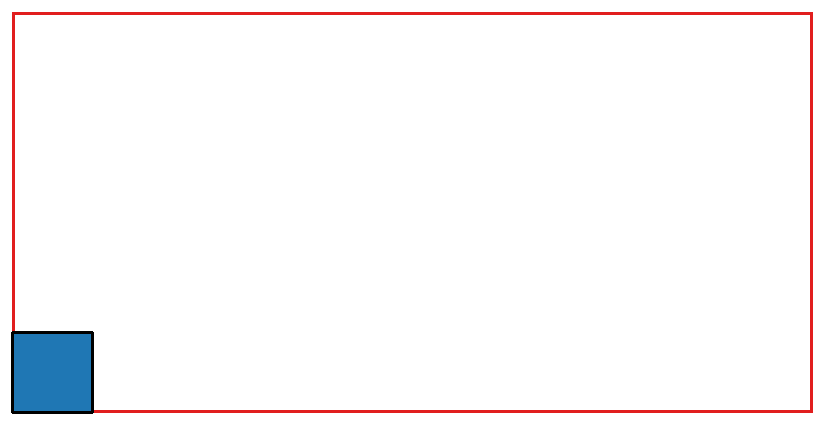

# Deterministic NFP Packer

A deterministic greedy solver for 2D irregular packing (nesting): place every
required convex polygon at least once, then fit as many more as possible into a
fixed **200 × 100** canvas — no overlaps, nothing past the boundary.

Placement is exact, not sampled. Candidate positions come from the **No-Fit
Polygon** (NFP) and **Inner-Fit Polygon** (IFP) boundaries, so the packer only
ever considers positions where a shape touches something. Every tie is broken
deterministically: same input → same layout, every time.

## Results

Three interchangeable modes, all deterministic and NFP-based. Each animation
replays the real placement order (generated from `layout.json`).

| Mode | Utilisation | Shapes | What it does |
|------|:-----------:|:------:|--------------|
| **simple** | **93.61 %** | 275 | `score = bbox_density + μ·contact`. Fast. Recommended. |
| **edge** | 93.53 % | 331 | Rotation derived from edge orientation (continuous angles). |
| **sophisticated** | 89.37 % | 905 | Lexicographic score + feasibility gate + future-flexibility. |

| simple | edge |
|:------:|:----:|
|  |  |

<sub>Red = canvas. Each shape is coloured by type; the newest placement is
outlined in black in the interactive viewer.</sub>

## How it works

Two phases:

1. **Coverage** — place every required shape type at least once.
2. **Fill** — repeat any type until nothing fits.

Each step generates every feasible candidate from the **forbidden-region union**
(the union of all placed NFPs — any touching placement lies on its boundary),
scores them, and places the best. Positions are always NFP/IFP-exact, which
keeps the packer robust: if a spot exists, it is found.

### Scoring modes

**`simple` (recommended).** A weighted score that keeps two things that matter:

```
score = bbox_density + μ · contact_ratio          (μ = 0.25 by default)
```

`bbox_density` is the used area over the bounding box of the whole cluster;
`contact_ratio` is how much of the new shape's perimeter touches its neighbours
or the walls. There is **no bottom-left bias** — a subtle point: because the
contact term can only shift the score by at most `μ`, the winner is evaluated
among all candidates whose density is within `μ` of the best, so a
higher-contact placement wins on equal density instead of being silently dropped
for being "less bottom-left".

**`edge`.** Instead of a preset rotation list (`0/90/180/270`), the useful
rotations are **derived from edge orientation** so a shape edge becomes flush
against a frontier edge (a neighbour's edge or a wall):

```
θ = angle(frontier_edge) + π − angle(candidate_edge)
```

This unlocks continuous angles (e.g. triangles at 30°/60°, tilted trapeziums)
that the 90° grid misses. Rotation comes from the edges; **positions still come
from the NFP search**, so robustness is preserved. It is slower (a fresh NFP
union per derived angle) and, for this shape set, does not beat `simple`.

**`sophisticated`.** The original design: a lexicographic score
(density → utilisation → future flexibility → contact → position), a hard
feasibility gate (every remaining mandatory type must keep ≥1 placement), and a
two-stage shortlist so the expensive metrics run on ~20 candidates, not all.

## Directory layout

```
main.py             entry point: run/resume, save, draw   (flags below)
validate.py         independent checker (overlaps, bounds, area)
run_forever.sh      supervisor: restarts and resumes if the process dies

src/                geometry and data model
  shapes.py           shape types + on-demand rotation variants
  layout.py           canvas, placements, cached aggregates, spatial index
  rotation_polygon.py rotate a polygon into a canonical local frame
  persistence.py      atomic save/load of placements (exact vertices)

algo/               the packing algorithm
  greedy.py           two-phase greedy driver + scoring modes
  nfp.py              no-fit polygon (convex, via Minkowski sum)
  nfp_cache.py        base-NFP cache; a placed NFP is the base translated
  nfp_candidate.py    candidate positions from the forbidden-region union
  edge_placement.py   edge-derived rotation set (edge mode)
  IFP.py              inner-fit polygon (canvas containment)
  metrics.py          cheap (O(1)) + expensive scoring metrics

viz/                visualisation
  export_viewer.py    interactive offline HTML step-viewer
  export_gif.py       animated GIF for the README

assets/             images used in this README (gifs + stills)
results*/           run outputs: layout.json, layout.png, step_viewer.html
docs/               design notes and pseudocode
```

`results/`, `results_simple/`, `results_edge/` hold the sophisticated, simple
and edge runs respectively.

## Requirements

```bash
pip install shapely matplotlib pillow
```

## Usage

```bash
python3 main.py                 # sophisticated mode
python3 main.py --simple        # simple mode (μ = 0.25)
python3 main.py --simple --mu 0.4
python3 main.py --edge          # edge-derived rotation (implies --simple)

python3 validate.py             # verify the saved layout independently
./run_forever.sh                # run, auto-restart + resume if killed
```

Each mode writes to its own folder, so runs never overwrite each other.

### Resume & persistence

Progress is checkpointed to `layout.json` after every placement with an **atomic
write**, so a run killed at any moment resumes exactly where it stopped
(placements are stored as exact vertices). The PNG is redrawn every 25
placements. When the packer finishes naturally it writes `DONE`, which stops the
supervisor loop.

## Visualisation

```bash
python3 viz/export_viewer.py results_simple   # -> results_simple/step_viewer.html
python3 viz/export_gif.py    results_edge assets/edge.gif --frames 150
```

The **step-viewer** is a single self-contained HTML file (no server, works
offline): scrub with the slider or arrow keys, `Space` plays. Each step
highlights the newest shape and draws the running bounding box (the denominator
of the density term), so you can watch *why* the greedy chose each placement.
