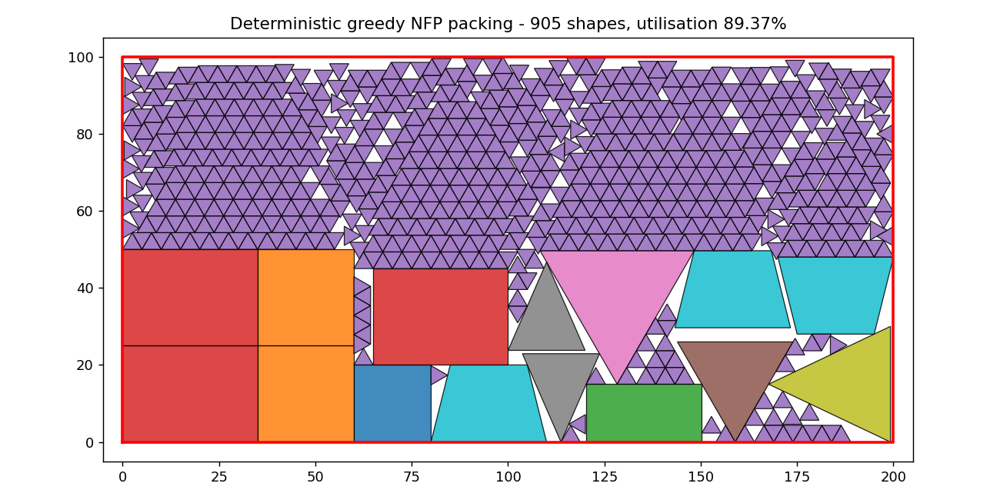

# Deterministic NFP Packer

A deterministic greedy solver for 2D irregular packing (nesting): fit as many
convex polygons as possible into a fixed 200 × 100 canvas, without overlaps and
without leaving the boundary.

Placement is exact, not sampled — candidate positions come from the
**No-Fit Polygon** (NFP) and **Inner-Fit Polygon** (IFP) boundaries, so the
packer only ever considers positions where a shape touches something.

**Current result: 905 shapes placed, 89.37 % canvas utilisation, 0 overlaps.**



## How it works

Two phases:

1. **Coverage** — place every required shape type at least once, behind a hard
   feasibility gate so a mandatory type can never get stranded.
2. **Fill** — repeat any type until nothing fits.

Each step scores candidates in two stages, because the good metrics are
expensive:

- **Cheap stage** — O(1) metrics over every feasible candidate.
- **Shortlist** — global top-20 by cheap score, plus top-2 per type so no type
  is accidentally dropped.
- **Expensive stage** — for the shortlist only: mandatory feasibility gate,
  exact contact ratio, and capped future flexibility.

Candidates are ranked by a **lexicographic score** (bounding-box density →
utilisation → future flexibility → contact ratio → position tie-breaks) rather
than weighted sums, which keeps the run fully deterministic — same input, same
layout, every time.

## Layout

```
main.py             entry point: run/resume the packer, save, draw
validate.py         independent checker (overlaps, bounds, area)
run_forever.sh      supervisor: restarts and resumes if the process dies

src/                geometry and data model
  shapes.py           shape types + rotation variants
  layout.py           the canvas, placements, spatial index
  rotation_polygon.py rotate a polygon into a canonical local frame
  persistence.py      atomic save/load of placements

algo/               the packing algorithm
  greedy.py           two-phase greedy driver
  nfp.py              no-fit polygon (convex)
  nfp_cache.py        cached NFPs for placed shapes
  nfp_candidate.py    candidate positions from the forbidden-region union
  IFP.py              inner-fit polygon (canvas containment)
  fasability.py       feasibility gate
  metrics.py          cheap + expensive scoring metrics

results/            output: layout.json, layout.png, run.log
docs/               design notes and pseudocode
```

## Requirements

```bash
pip install shapely matplotlib
```

## Usage

```bash
python3 main.py       # run, or resume from results/layout.json if present
./run_forever.sh      # same, but auto-restarts if the process is killed
python3 validate.py   # verify the saved layout independently
```

Progress is checkpointed to `results/layout.json` after every placement using an
atomic write, so a run killed at any moment resumes exactly where it stopped.
The PNG is redrawn every 25 placements (drawing is slow). When the packer
finishes naturally it writes `results/DONE`, which stops the supervisor loop.
